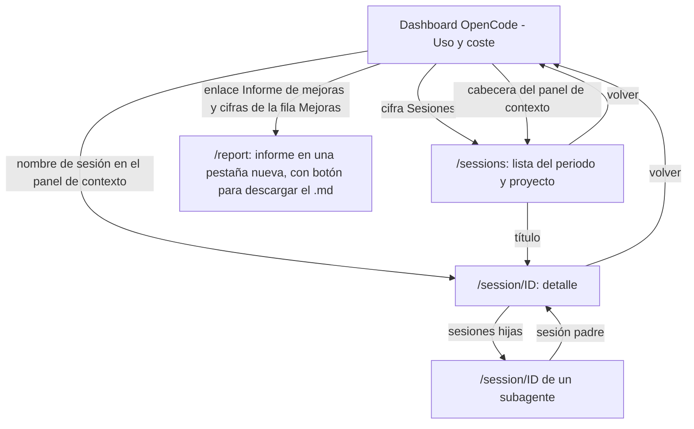

# Guía del dashboard de OpenCode

## Qué es

«OpenCode - Uso y coste» responde a «cuánto uso OpenCode, cuánto cuesta, dónde se va el gasto y cuánto contexto queda en mis sesiones». Todos los datos salen de la base de datos de OpenCode, así que el dashboard muestra el historial completo y no solo lo recogido desde que se arrancó la pila.

Los paneles van de lo general a lo particular: primero las cifras de resumen, después el contexto de las sesiones, la tendencia y los repartos, y al final el detalle.

## Cómo se navega

## Selectores

Arriba hay tres selectores. El selector de tiempo de Grafana está oculto porque los paneles no lo usan.

| Selector | Qué hace |
| --- | --- |
| Periodo | Elige los últimos 7, 30 o 90 días, todo el historial o **Personalizado**. |
| Desde y Hasta | Solo se usan con Personalizado: eligen el primer y el último día del rango, entre los días con actividad. Con cualquier otro periodo se ignoran. |
| Proyecto | Filtra por una o varias carpetas de proyecto. |

Los días se cuentan en UTC, así que una actividad cercana a la medianoche puede caer en el día anterior o en el siguiente. Las listas de Desde y Hasta se leen al cargar el dashboard.

## Panel por panel

### Cifras de resumen

| Panel | Tipo | Qué muestra | Qué aporta |
| --- | --- | --- | --- |
| Coste estimado | Stat | Coste estimado del periodo elegido. | La cifra principal de gasto. |
| Tokens | Stat | Tokens de entrada, salida, razonamiento y caché sumados, en millones. | El volumen global de un vistazo. |
| USD por millón de tokens | Stat | El coste dividido entre los tokens. | El precio efectivo. Baja si se usan modelos más baratos o se aprovecha más la caché. |
| Acierto de caché | Stat | Lectura de caché entre lectura de caché, escritura de caché y entrada. | Cuánto contexto se reutiliza en lugar de rehacerse. Un valor alto es barato. |
| Sesiones | Stat | Sesiones principales creadas en el periodo; las de subagente no cuentan. | Distingue pocas sesiones largas de muchas cortas. Pulsa la cifra para ver la lista de esas sesiones. |

### Contexto

| Panel | Tipo | Qué muestra | Qué aporta |
| --- | --- | --- | --- |
| Contexto de las sesiones recientes | Tabla con barras | Para cada una de las cinco sesiones más recientes: el porcentaje de la ventana de contexto del modelo que ocupa (barra verde por debajo del 60 %, naranja hasta el 85 % y roja por encima), los tokens usados, los tokens libres y el límite del modelo. | Cuánto falta para que una sesión llegue al límite y deba compactarse. Una sesión cuyo modelo no tiene límite conocido sale con «Sin límite». Pulsa el nombre de una sesión para abrir su detalle en otra pestaña. Sigue el selector de proyecto, pero no el de periodo, porque muestra el estado actual. |

El contexto de una sesión es el tamaño de su último mensaje respondido, igual que en la barra lateral de OpenCode. El límite sale de la caché de modelos de OpenCode; si un modelo no está en ella, como los de proveedores internos, su sesión sale con «Sin límite» hasta que se indique el límite en `CONTEXT_LIMITS` del fichero `.env`.

### Cuota por proveedor

| Panel | Tipo | Qué muestra | Qué aporta |
| --- | --- | --- | --- |
| Cuota y uso por proveedor | Tabla con barras | Mensajes, tokens y coste de cada proveedor en el periodo y, para los que tienen cuota, el porcentaje usado (barra verde por debajo del 60 %, naranja hasta el 85 % y roja por encima), lo usado, el total, lo disponible, cuándo se restablece y cuándo se consultó por última vez. Si no se puede leer la cuota de un proveedor, sale el mensaje del plugin. | Cuánta cuota queda en los proveedores que la tienen y el uso de los que no, como los internos o los locales, que salen con «—». Sigue el selector de periodo y de proyecto en la parte de uso, pero la cuota es siempre la última leída. |

La cuota la lee el exportador de los ficheros que guarda el plugin opencode-quota en la caché de OpenCode. Por eso solo existe para los proveedores que ese plugin soporta, es tan reciente como su última consulta (la columna «Dato de» la indica) y, si un proveedor informa de varias cuotas, se muestra la que menos le queda.

### Evolución y repartos

| Panel | Tipo | Qué muestra | Qué aporta |
| --- | --- | --- | --- |
| Evolución semanal | Barras y línea | El coste de cada semana en barras (eje izquierdo) y los tokens en una línea (eje derecho), las últimas 13 semanas. | La tendencia: semanas caras y si el coste y el volumen suben juntos. Sigue el selector de proyecto, pero no el de periodo. |
| Coste por agente | Barras | Coste de cada agente (`plan`, `build` y los propios) en el periodo. | Muestra qué modo de trabajo concentra el gasto. |
| Coste por proyecto | Barras | Coste de cada carpeta de proyecto en el periodo; `global` agrupa lo que OpenCode no asocia a ninguno. | Atribuye el gasto a proyectos. |
| Cuota de coste y de tokens por modelo | Barras agrupadas | Para los diez modelos con más coste, su parte del coste total y su parte de los tokens totales. `Otros` suma el resto. | Un modelo cuya barra de tokens es mucho más larga que la de coste es barato; al revés, caro. Comparar ambas cuotas es más útil que verlas por separado. |

### Skills y comandos

| Panel | Tipo | Qué muestra | Qué aporta |
| --- | --- | --- | --- |
| Comandos | Tabla anidada | Una fila por comando propio ejecutado en el periodo, de mayor a menor coste: las activaciones (barra) y el coste de los turnos que lanzó (barra). Al desplegar una fila, el agente y el modelo que respondieron, con su parte del coste y las activaciones que se les atribuyen. | Muestra qué comandos se usan de verdad y con qué modelos se ejecutaron. No es el coste del comando solo: incluye todo lo demás que pasó en el turno, así que es una cota superior. Sale vacía si en el periodo no se usó ninguno. |
| Skills | Tabla anidada | Una fila por skill cargada en el periodo, de mayor a menor coste: las activaciones (barra), el coste de los turnos en que se cargó (barra) y las cargas que fallaron. Al desplegar una fila, el agente y el modelo que respondieron, con su parte del coste. Si un turno carga varias skills, su coste se reparte a partes iguales. | Muestra qué skills se usan de verdad y con qué modelos. Incluye todo lo demás que pasó en el turno, así que es una cota superior. Sale vacía si en el periodo no se cargó ninguna. |

Un turno son todos los mensajes del asistente que responden a un mismo mensaje tuyo. Las skills salen de las llamadas a la herramienta `skill` que OpenCode guarda; solo se lee el nombre y el resultado, no lo que devolvió la skill. Los comandos propios (como `/ai-commit`) no dejan marca en la base de datos: OpenCode guarda su plantilla ya expandida como texto del mensaje, y el exportador reconoce un comando cuando un mensaje empieza con su plantilla. Por eso solo se ven los comandos de la carpeta global de comandos de OpenCode, no los definidos dentro de un proyecto, y no se cuenta un comando cuya plantilla empiece igual que la de otro.

### Detalle

| Panel | Tipo | Qué muestra | Qué aporta |
| --- | --- | --- | --- |
| Detalle por modelo | Tabla | Mensajes, tokens, coste, porcentaje del coste y USD por millón de tokens de cada proveedor y modelo, de mayor a menor coste. El pie suma mensajes, tokens, coste y porcentaje. | Las cifras exactas detrás de los gráficos, para copiarlas a un informe. El reparto por agente está en su panel. |
| Coste por día y modelo | Barras apiladas | El coste de cada día del periodo, apilado por los ocho modelos con más coste; `Otros` suma el resto. Solo salen los días con actividad. | Qué modelo explica el gasto de cada día. Se lee bien de 7 a 90 días; con todo el historial hay muchas barras. |
| Actividad por día y modelo | Tabla | Mensajes, tokens y coste de cada modelo en cada día del periodo, con filtro por columna. | Responde a «¿usé el modelo X el día Y?». Es de consulta: sirve para buscar un día o un modelo concretos. La fila «Actividad diaria por modelo» que la contiene se puede plegar. |

### Mejoras

La última fila resume el informe de mejoras: lo que el usuario puede cambiar (reglas en AGENTS.md, modelos de agentes y comandos, hábitos al escribir prompts) para gastar menos y que los agentes fallen menos. Sirve también para comprobar, semanas después, si un cambio funcionó. El informe completo, con la recomendación de cada hallazgo y sesiones de ejemplo, se abre en una pestaña nueva con el enlace **Informe de mejoras** de arriba a la derecha o pulsando las cifras de esta fila. En esa página las sesiones de ejemplo enlazan con su detalle, y los botones de arriba descargan el informe (.md), copian su Markdown u ocultan los nombres de proyecto antes de compartirlo.

| Panel | Tipo | Qué muestra | Qué aporta |
| --- | --- | --- | --- |
| Mejoras detectadas | Cifra | Número de hallazgos del informe en el periodo y los proyectos elegidos, también con el periodo Personalizado. | Cuánto hay por mejorar. |
| Impacto estimado | Cifra | Suma del impacto en dólares de esos hallazgos. | Un orden de magnitud del gasto evitable, en coste equivalente; no es un ahorro garantizado. |
| Errores evitables de herramientas | Cifra | Parte de las llamadas a herramientas que fallaron, sin bloqueos por permisos, rechazos ni interrupciones. | La salud general del uso de herramientas en el periodo y el proyecto elegidos. |
| Compactaciones e interrupciones | Cifra doble | Compactaciones de contexto y respuestas interrumpidas en el periodo. | Muchas compactaciones apuntan a sesiones demasiado largas; muchas interrupciones, a prompts que arrancan mal. |
| Hallazgos por regla | Tabla | Por cada regla del informe: hallazgos, cuántos son de severidad alta e impacto. | Qué tipo de mejora pesa más. |
| Hallazgos | Tabla | Cada hallazgo, de mayor a menor severidad (alta en rojo, media en naranja): regla, qué pasa, impacto, casos, recomendación y evidencia. | Qué cambiar sin descargar el informe. Pasa el ratón por una celda o usa «Inspect» para leer los textos largos; el informe añade sesiones de ejemplo. |
| Errores evitables por herramienta y modelo | Tabla | Llamadas, errores y tasa de cada combinación de herramienta y modelo que haya fallado; naranja desde el 5 % y rojo desde el 15 %. | Dónde compensa una regla en AGENTS.md o usar otro modelo para esa herramienta. |
| Coste por mensaje de cada agente, por semana | Líneas | Coste medio por mensaje de cada agente, las últimas 13 semanas. | Comprueba si cambiar el modelo de un agente baja su coste. Sigue el proyecto, no el periodo. |
| Errores evitables por herramienta, por semana | Líneas | Tasa de error semanal de las cinco herramientas con más errores evitables. | Comprueba si una regla nueva o un cambio de modelo reduce los fallos. |
| Compactaciones e interrupciones, por semana | Barras | Las dos cifras por semana, las últimas 13. | La tendencia de esas dos señales. |

Los cuatro paneles de hallazgos (Mejoras detectadas, Impacto estimado, Hallazgos por regla y Hallazgos) calculan el informe al abrir el dashboard, con el periodo y los proyectos elegidos, igual que el informe que se descarga, pero con los datos que el exportador leyó por última vez, como mucho de hace unos dos minutos; así cargan en décimas de segundo. Si esos datos tienen más de 30 segundos, el exportador los vuelve a leer en segundo plano para la siguiente consulta. El informe descargado lee siempre la base de datos en el momento. El resto de paneles de la fila sale de Prometheus, cuyas series se recalculan cada 2 minutos.

## Detalle de una sesión

Al pulsar el nombre de una sesión en el panel de contexto se abre, en otra pestaña, una página con su detalle (`http://localhost:9101/session/<id>`). La sirve el exportador y la construye desde la base de datos de OpenCode en el momento de abrirla.

| Apartado | Qué muestra |
| --- | --- |
| Cabecera | El título, el proyecto, el número de mensajes del asistente, la duración, cuándo se creó y se actualizó, y un enlace para volver al dashboard (y a la sesión padre si es un subagente). |
| Cifras | Coste estimado, tokens, cambios en archivos (líneas añadidas y quitadas), herramientas llamadas y compactaciones. |
| Contexto | Una barra con el porcentaje de la ventana de contexto en uso, dividida en entrada, caché leída, caché escrita y salida, y los tokens que quedan hasta el límite. |
| Evolución | Un gráfico con el tamaño del contexto en cada mensaje, con una línea amarilla donde hubo una compactación, y otro con el coste acumulado. |
| Modelos y agentes | Mensajes, tokens y coste de cada combinación de modelo, proveedor y agente. |
| Skills y comandos | Cuáles se usaron en la sesión y cuántas veces. |
| Herramientas | Las llamadas a cada herramienta y cuántas fallaron. |
| Sesiones hijas | Los subagentes que lanzó la sesión, con su coste y un enlace a su propia página. |

La página no muestra el texto de la conversación y solo funciona en la máquina que ejecuta la pila, porque los enlaces apuntan a `localhost`.

## Lista de sesiones

La cifra **Sesiones** y la cabecera del panel «Contexto de las sesiones recientes» enlazan con `http://localhost:9101/sessions`, que se abre en otra pestaña. Es la lista de todas las sesiones creadas en el periodo y el proyecto que hay elegidos en el dashboard, de modo que su número coincide con la cifra.

| Elemento | Qué hace |
| --- | --- |
| Cuadro de filtro | Deja solo las filas que contienen el texto escrito en el título, el proyecto o el agente. |
| Cabeceras | Al pulsarlas ordenan la lista por esa columna; una segunda pulsación invierte el orden. |
| Título | Enlaza con la página de detalle de la sesión. |
| Columnas | Proyecto, agente, mensajes del asistente, tokens, coste estimado, y cuándo se creó y se actualizó. |
| Subagentes | Ocultos por defecto, como en la cifra; un enlace sobre la lista los incluye y los marca con una etiqueta. |

Si se elige un periodo personalizado o un proyecto concreto, la lista parte de esa misma elección. Los días se cuentan en UTC.

## Cómo leer las cifras

- **El coste es una estimación.** Es el valor que OpenCode guarda en cada mensaje, no una factura. En proveedores por suscripción puede no reflejar lo que realmente se paga.
- **Los tokens se muestran en millones o en miles.** Se escriben con el sufijo «M» o «k»; el formato en español de Grafana escribe «Mil» para millones, que se confunde fácilmente con miles.
- **Cuota frente a cantidad.** En el gráfico de modelos importa la diferencia entre las dos barras, no su longitud absoluta.
- **El gráfico semanal y el contexto ignoran el periodo.** El primero muestra siempre las últimas 13 semanas; el segundo, las cinco sesiones más recientes.
- **Los totales pueden bajar.** Se recalculan desde la base de datos en cada lectura; si OpenCode borra sesiones antiguas, el historial se reduce.
- **`global`** no es un proyecto real: son las sesiones que OpenCode no tiene asociadas a una carpeta.
- **Títulos de sesión.** La tabla de contexto muestra los títulos de las sesiones, que OpenCode genera a partir de las conversaciones; conviene tenerlo en cuenta antes de compartir una captura.
