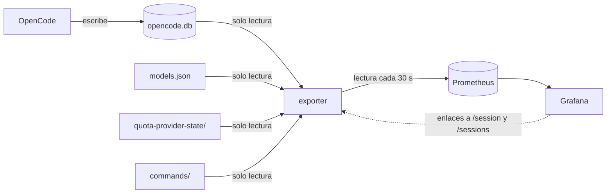
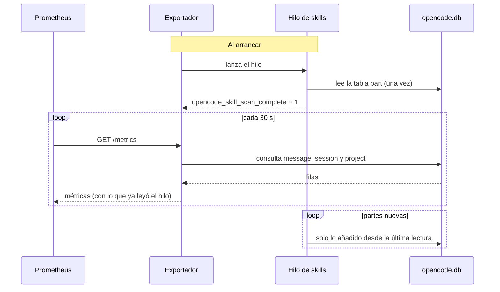
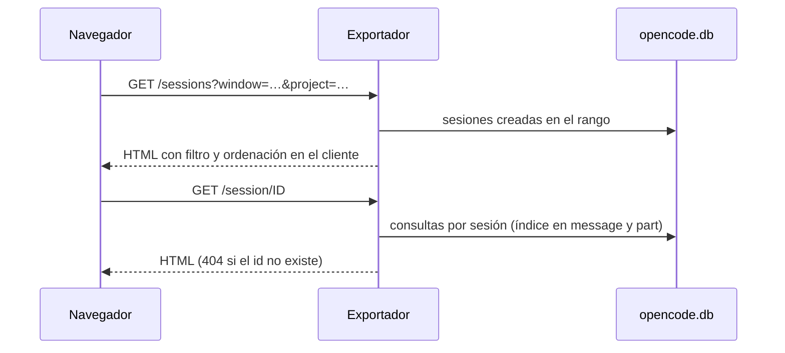

# Infraestructura de métricas de OpenCode

## Resumen

Una pila local de tres contenedores (un exportador, Prometheus y Grafana) que mide el uso de OpenCode leyendo su propia base de datos SQLite. No usa OpenTelemetry ni cambia la configuración de OpenCode. Como OpenCode ya guarda el coste y los tokens de cada mensaje, la pila muestra el historial completo desde el primer arranque.

Todo corre con Docker Compose en la carpeta del proyecto. Prometheus conserva las métricas 365 días. Hay un dashboard provisionado, «OpenCode - Uso y coste», con un selector de periodo (con rango personalizado) y otro de proyecto.

## Qué se hizo y por qué

La pregunta de partida era si se podían medir las métricas de OpenCode como ya se hacía con Claude Code. Se valoraron dos caminos.

| Opción | Cómo funciona | Por qué sí o por qué no |
| --- | --- | --- |
| Leer la base de datos de OpenCode (elegida) | Un exportador consulta el SQLite local en solo lectura y publica métricas para Prometheus. | Ya contiene coste, tokens, modelo, agente y proyecto de cada mensaje. Da historial inmediato, no depende de funciones experimentales y no exige tocar la configuración de OpenCode. |
| Telemetría nativa de OpenCode | Con `experimental.openTelemetry: true`, OpenCode emite trazas OTLP; hay además un plugin de la comunidad que emitiría métricas. | Es experimental y emite trazas, no métricas: habría que convertirlas en un collector o añadir un backend de trazas. La documentación oficial de configuración no la menciona, y no se probó con la versión instalada. Solo contaría desde que se active. |

Se decidió además hacerlo como un proyecto independiente y no como un servicio más de la pila de Claude Code, por cuatro razones: la fuente de datos es otra (SQLite frente a OTLP), cada proyecto se puede publicar por separado, el acceso a la carpeta de datos de OpenCode queda aislado en su propio contenedor y cada README cuenta una sola cosa. Los puertos son distintos de los de la otra pila, así que pueden funcionar a la vez.

## Arquitectura

OpenCode escribe su actividad en `opencode.db`. El exportador, montado en solo lectura, la consulta cada vez que Prometheus lo lee (cada 30 segundos) y devuelve los datos. También lee el `models.json` de la caché de OpenCode para conocer el límite de contexto de cada modelo. Prometheus guarda las series y Grafana las dibuja.

Ciclo de una lectura, con la lectura de `part` en segundo plano:

Apertura en el navegador de una página de sesión o de la lista:

## Componentes

| Componente | Qué hace | Puertos | Persistencia |
| --- | --- | --- | --- |
| Exportador (`python:3.13-alpine`) | Consulta las tablas `message`, `session` y `project`, lee los límites de contexto y publica las métricas en formato Prometheus. | 127.0.0.1:9101 | ninguna: recalcula en cada lectura |
| Prometheus (`prom/prometheus:v3.5.0`) | Lee el exportador cada 30 s y guarda las series; motor de consulta PromQL. | 127.0.0.1:9091 | volumen `prometheus-data`, retención de 365 días |
| Grafana (`grafana/grafana:12.1.0`) | Visualización. Los datasources (Prometheus y Coach) y el dashboard se cargan solos al arrancar; el plugin Infinity, que usa Coach, se instala al arrancar con `GF_PLUGINS_PREINSTALL_SYNC`. | 127.0.0.1:3001 | volumen `grafana-data` |
| Docker Compose | Levanta los tres contenedores con `restart: unless-stopped` y monta los ficheros de configuración y las carpetas de OpenCode en solo lectura. | n/a | n/a |

Las imágenes llevan versión fijada, para que la pila no cambie sola, y los puertos se publican solo en `127.0.0.1`.

## El exportador

`exporter/exporter.py` es un servidor HTTP mínimo. En cada lectura abre `opencode.db` y calcula:

- Coste, tokens y mensajes del asistente por día UTC y por proveedor, modelo, agente y proyecto, sobre todo el historial.
- Sesiones principales creadas cada día (las de subagente no cuentan).
- Coste y tokens por semana y proyecto, las últimas 13 semanas.
- Activaciones y coste por skill y por comando propio: las llamadas a la herramienta `skill`, los comandos reconocidos en los mensajes del usuario y el coste de los turnos que los contienen.
- El contexto de las cinco sesiones más recientes: los tokens de su último mensaje respondido, y el límite de contexto de su modelo.
- La cuota de cada proveedor, leída de los ficheros de estado que guarda el plugin opencode-quota.
- Totales acumulados, por compatibilidad, y su propio tiempo de lectura.

Decisiones que conviene conocer:

- **Solo metadatos de los mensajes.** Lee de cada mensaje el rol, el modelo, el agente, el coste, los tokens y la fecha. Nunca lee el texto de los mensajes. Para la tabla de contexto lee además el título de las cinco sesiones más recientes.
- **Solo mensajes del asistente.** Son los que llevan coste y tokens.
- **Proyecto.** Es el nombre de la carpeta del proyecto. Las sesiones que OpenCode no asocia a ninguno, o que cuelgan de la raíz, salen como `global`.
- **Límites de contexto.** Salen del `models.json` de OpenCode, que se vuelve a leer solo cuando cambia el fichero. Se prueban las dos grafías de versión (`4.6` y `4-6`). Para los modelos que no están, como los de proveedores propios, hay una variable `CONTEXT_LIMITS` con pares `proveedor/modelo=tokens`. Una sesión sin límite conocido se publica sin límite y la tabla la muestra con «Sin límite».
- **Contexto de una sesión.** Es el tamaño del último mensaje con tokens, igual que en la barra lateral de OpenCode; se salta el mensaje abortado o en curso que aún no lleva tokens.
- **Skills.** Cada vez que el modelo carga una skill, OpenCode guarda una llamada a la herramienta `skill` en la tabla `part`. El coste de una skill no se puede aislar, así que se atribuye a la skill el coste del turno completo (todos los mensajes del asistente que responden al mismo mensaje del usuario), repartido a partes iguales si el turno carga varias. Es una cota superior.
- **Comandos propios.** OpenCode no marca los comandos en la base de datos: guarda su plantilla ya expandida como texto del mensaje del usuario. El exportador lee las plantillas de la carpeta global de comandos (montada en solo lectura, sin el resto de la configuración de OpenCode) y reconoce un comando cuando un mensaje empieza con su plantilla, hasta el primer `$ARGUMENTS`; gana la plantilla más larga y un empate no cuenta. Solo se ven los comandos de esa carpeta, no los definidos dentro de un proyecto. El coste de un comando es el de su turno.
- **Lectura en segundo plano.** La tabla `part` guarda todas las salidas de herramientas y recorrerla a través de un montaje de Docker en Windows tardaba más de veinte segundos, más que el plazo de lectura de Prometheus. Un hilo la lee una vez al arrancar y después solo las partes nuevas, y las lecturas sirven lo que ya hay. Las métricas de skills aparecen unos veinte segundos después de arrancar; `opencode_skill_scan_complete` indica cuándo.
- **Cuota.** Los ficheros de estado del plugin opencode-quota, uno por proveedor, dan el porcentaje que queda, un texto como `22/7000`, la fecha de reinicio y los errores. El exportador convierte el texto en usado y total, traduce el nombre del proveedor del plugin al de OpenCode (`copilot` es `github-copilot`) y, si un proveedor tiene varias cuotas, publica la que menos le queda. Nunca lee la clave que esos ficheros también contienen. Los proveedores internos y locales no aparecen porque el plugin no los soporta.
- **Filtro por fechas.** PromQL no puede comparar fechas escritas como etiquetas, así que el exportador publica el inicio de cada día como un valor numérico y el dashboard filtra comparándolo.
- **Páginas de detalle de sesión.** Además de las métricas, el exportador sirve `/session/<id>`: una página HTML con el detalle de una sesión (contexto, evolución del contexto y del coste, modelos, skills, comandos, herramientas y subagentes). Se construye al abrirla con consultas por sesión, que son rápidas porque `message` y `part` tienen índice por sesión. La lógica de pintado está en `session_page.py` y la de lectura en `exporter.py`; por eso el compose monta la carpeta `exporter/` y no un solo fichero. Se publica solo en `127.0.0.1`.
- **Lista de sesiones.** `/sessions` muestra las sesiones creadas en un rango, con sus mensajes, tokens y coste, y admite en la dirección el periodo (`window`, o `from` y `to` en tiempo Unix si es personalizado), el proyecto (`project`) y si se incluyen los subagentes (`subagents`). El dashboard rellena esos datos con las variables de sus selectores. Por defecto cuenta solo las sesiones principales y por fecha de creación, igual que la cifra «Sesiones», para que ambos números coincidan; el filtro de texto y la ordenación se hacen en el navegador.
- **Lectura segura.** La base de datos está en modo WAL. El exportador la abre primero con `mode=ro`, que respeta el registro de escritura; si el montaje de solo lectura no lo permite, recurre a `immutable=1`, que ignora el registro y puede ir unos megabytes por detrás.
- **Errores visibles.** Si la lectura falla, responde con un error 500 para que Prometheus lo marque, en lugar de devolver un 200 vacío.

## Métricas

| Métrica | Tipo | Etiquetas | Significado |
| --- | --- | --- | --- |
| `opencode_day_cost_usd` | gauge | `day`, `provider`, `model`, `agent`, `project` | Coste estimado de cada día UTC, sobre todo el historial |
| `opencode_day_tokens` | gauge | las cinco anteriores y `type` | Tokens de cada día (`input`, `output`, `reasoning`, `cache_read`, `cache_write`) |
| `opencode_day_messages` | gauge | `day`, `provider`, `model`, `agent`, `project` | Mensajes del asistente de cada día |
| `opencode_day_sessions` | gauge | `day`, `project` | Sesiones principales creadas cada día |
| `opencode_day_start_seconds` | gauge | `day` | Inicio de cada día UTC como tiempo Unix, para filtrar por fechas |
| `opencode_day_skill_cost_usd` | gauge | `day`, `kind`, `skill`, `project` | Coste de los turnos en los que se cargó cada skill o se ejecutó cada comando (`kind` es `skill` o `command`) |
| `opencode_day_skill_activations` | gauge | `day`, `kind`, `skill`, `project`, `result` | Veces que se cargó cada skill o se ejecutó cada comando (`ok` o `error`) |
| `opencode_day_skill_detail_cost_usd` | gauge | `day`, `kind`, `skill`, `project`, `provider`, `model`, `agent` | El mismo coste separado por el modelo y el agente que respondieron al turno |
| `opencode_day_skill_detail_activations` | gauge | `day`, `kind`, `skill`, `project`, `provider`, `model`, `agent`, `result` | Las mismas activaciones, atribuidas al modelo y agente del mensaje que cargó la skill o, en un comando, al que más gastó en su turno |
| `opencode_skill_scan_complete` | gauge | ninguna | 1 cuando el exportador ya leyó las llamadas a skills |
| `opencode_weekly_cost_usd` | gauge | `week`, `project` | Coste por semana, últimas 13; `week` es el lunes de la semana ISO |
| `opencode_weekly_tokens` | gauge | `week`, `project` | Tokens (todos los tipos sumados) por semana |
| `opencode_context_tokens` | gauge | `session`, `label`, `project`, `provider`, `model`, `type` | Tokens del último mensaje de cada una de las cinco sesiones más recientes (`input`, `cache_read`, `cache_write`, `output`) |
| `opencode_context_limit_tokens` | gauge | como la anterior, sin `type` | Límite de contexto del modelo; no existe si se desconoce |
| `opencode_quota_remaining_ratio` | gauge | `provider` | Parte de la cuota que sigue disponible (de 0 a 1) |
| `opencode_quota_used`, `opencode_quota_limit` | gauge | `provider` | Cuota usada y total, cuando el plugin la da como un par |
| `opencode_quota_reset_timestamp_seconds` | gauge | `provider` | Cuándo se restablece la cuota |
| `opencode_quota_updated_timestamp_seconds` | gauge | `provider` | Cuándo consultó el plugin la cuota por última vez |
| `opencode_quota_error` | gauge | `provider`, `message` | El plugin no pudo leer la cuota de ese proveedor |
| `opencode_cost_usd_total`, `opencode_tokens_total`, `opencode_messages_total` | counter | `provider`, `model`, `agent`, `project` (y `type`) | Totales acumulados, por si se consultan directamente |
| `opencode_exporter_scrape_seconds` | gauge | ninguna | Duración de la última lectura |
| `opencode_day_tool_calls` | gauge | `day`, `tool`, `model`, `project` | Llamadas a herramientas de cada día |
| `opencode_day_tool_errors` | gauge | `day`, `tool`, `error_class`, `model`, `project` | Llamadas que fallaron, con la clase del error |
| `opencode_day_compactions` | gauge | `day`, `project` | Compactaciones de contexto de cada día |
| `opencode_day_aborted` | gauge | `day`, `agent`, `project` | Respuestas interrumpidas de cada día |
| `opencode_weekly_agent_cost_usd`, `opencode_weekly_agent_messages` | gauge | `week`, `agent`, `project` | Coste y mensajes por semana y agente, últimas 13 semanas |
| `opencode_weekly_tool_calls`, `opencode_weekly_tool_errors` | gauge | `week`, `tool` (y `error_class`), `project` | Llamadas y errores por semana y herramienta |
| `opencode_weekly_compactions`, `opencode_weekly_aborted` | gauge | `week`, `project` | Compactaciones e interrupciones por semana |
| `coach_index_ready`, `coach_series_updated_timestamp_seconds` | gauge | ninguna | Índice de herramientas leído; cuándo se calcularon por última vez las series de «Mejoras» |

Prometheus solo guarda lo que ve mientras la pila funciona, así que no puede recortar por fechas unos totales acumulados ni reconstruir el pasado. Por eso las métricas llevan el día como etiqueta y el dashboard elige el rango. Con una base de datos de uso diario de varios meses, la lectura completa tarda unos tres segundos en el montaje de Windows y publica unas siete mil series.

## Dashboard

«OpenCode - Uso y coste» tiene 26 paneles: cinco cifras de resumen, una tabla con el contexto de las sesiones recientes, otra con la cuota y el uso por proveedor, un gráfico semanal, el coste por agente y por proyecto, una comparación de coste y tokens por modelo, dos tablas anidadas, una de comandos y otra de skills, con el modelo y el agente de cada una, una tabla de detalle, en una fila que se puede plegar, un gráfico y una tabla de la actividad diaria por modelo, y una última fila, «Mejoras», con diez paneles que resumen el informe de mejoras, con la lista de hallazgos, y siguen sus señales semana a semana. Arriba a la derecha, el enlace «Informe de mejoras» abre el informe en una pestaña nueva, desde la que se descarga. La explicación de cada panel está en la guía del dashboard.

### Selectores

- **Periodo:** los últimos 7, 30 o 90 días, todo el historial o Personalizado. Con Personalizado, **Desde** y **Hasta** eligen los días de inicio y fin entre los días con actividad; con cualquier otro periodo se ignoran.
- **Proyecto:** filtra por una o varias carpetas de proyecto.
- El selector de tiempo de Grafana está oculto: los paneles no lo usan.

Se descartó el selector de tiempo nativo de Grafana para el rango personalizado. Con una fecha final pasada, Grafana evalúa las consultas instantáneas en esa fecha y Prometheus no tiene datos de entonces, porque la pila empezó a recoger después; los paneles salían vacíos. Con los selectores propios las consultas se evalúan siempre en el momento actual y el rango se aplica filtrando los días.

### Criterios del diseño

El rediseño partió de un análisis de los 15 paneles anteriores con los datos reales y de la guía oficial de [buenas prácticas de Grafana](https://grafana.com/docs/grafana/latest/visualizations/dashboards/build-dashboards/best-practices/): de lo general a lo particular, cada gráfico obvio, pocos paneles y cuidado con los apilados y las escalas.

| Problema encontrado | Decisión |
| --- | --- |
| Los gráficos por día mostraban 90 fechas rotadas con datos solo en la mitad de los días, y los 5 días más caros sumaban casi la mitad del coste | Un único gráfico semanal con 13 etiquetas, con el coste en barras y los tokens en línea con eje propio |
| El selector de tiempo de Grafana no afectaba a casi ningún panel | Selector de periodo propio, con rango personalizado, y selector de tiempo oculto |
| Los paneles de coste por modelo y de tokens por modelo listaban modelos distintos y no se podían comparar | Un gráfico con la cuota de coste y la cuota de tokens de cada modelo, en porcentajes para compartir escala |
| El circular por proveedor tenía una sola categoría con coste | Se quitó; el proveedor sigue en la tabla de detalle |
| El panel de tokens por tipo no dejaba ver la salida y lo importante era la caché | Se sustituyó por la cifra «Acierto de caché» |
| El panel por intervalo estaba vacío y tenía una leyenda de 32 modelos | Se quitó |
| Los degradados de verde a rojo parecían alertas sin que hubiera umbrales | Un color fijo por magnitud, el mismo en todo el dashboard; solo la barra de contexto usa umbrales, que sí significan algo |
| «Mil» se leía como miles y significa millones | Tokens en millones o miles con el sufijo «M» o «k» |
| No había forma de ver cuánto contexto queda en una sesión | Tabla con una barra de porcentaje, los tokens usados y libres, y el límite; las sesiones sin límite conocido salen con «Sin límite» |
| Solo cinco sesiones eran accesibles, y la cifra «Sesiones» era un número sin salida | La cifra y la cabecera del panel de contexto enlazan con una lista de todas las sesiones del periodo y el proyecto elegidos |
| La tabla de contexto no permitía ver más de una sesión: cómo había crecido el contexto, qué herramientas había llamado o qué subagentes había lanzado | Cada sesión de la tabla enlaza a una página de detalle que se abre en otra pestaña |
| No se veía qué skills se usaban ni lo que costaban | Una tabla por skill con activaciones, coste y coste por activación. Se probó antes con dos gráficos de barras, pero con una sola skill en el periodo mostraban una barra sin nombre y no aportaban nada |
| Los comandos propios (`/ai-commit`, `/ai-1-spec`…) no aparecían, porque no son llamadas a la herramienta `skill` | La misma tabla los incluye con el tipo «Comando», reconocidos por el principio de su plantilla |
| La actividad diaria por modelo solo existía como tabla | Un gráfico de barras apiladas por modelo sobre la tabla; sigue el periodo elegido, así que se lee bien en rangos de hasta unos 90 días |
| No se veía la cuota de los proveedores ni el uso de los que no tienen | Tabla por proveedor con el uso del periodo y, si hay cuota, lo usado, lo disponible y cuándo se restablece; los proveedores sin cuota salen con «—» |

El coste por proyecto se mantuvo porque se quiere saber qué proyecto gasta más, aunque hoy uno concentre casi todo. La barra de contexto se hizo como tabla con celdas de barra porque el gráfico de barras apiladas de Grafana no muestra los valores sobre las barras y aquí interesan el porcentaje y los tokens exactos.

El dashboard no se importa a mano: Grafana lo carga al arrancar desde `Grafana/` mediante `grafana-dashboards.yaml`, y los datasources desde `grafana-datasource.yaml`: Prometheus (uid `prometheus`) y Coach (uid `coach`, tipo Infinity), que lee el informe de mejoras del exportador y solo puede pedir a `http://exporter:9101`. La carpeta se monta en solo lectura, así que los cambios se hacen en el JSON y se recargan al reiniciar Grafana.

## Informe de mejoras

El exportador incluye un módulo, `exporter/coach/`, que analiza el uso, detecta mejoras que puede aplicar el usuario y genera un informe en Markdown para compartirlo con una IA. Es la fase 1 del «coach» de uso de agentes; la fase 2 expondrá los mismos datos como servidor MCP para consultarlos bajo demanda.

| Fichero | Qué hace |
| --- | --- |
| `coach/errors.py` | Reduce el mensaje de error de cada herramienta a una clase (`not_found`, `patch_mismatch`, `permission_rule`…) y asocia a cada clase un consejo |
| `coach/index.py` | Índice en memoria de las llamadas a herramientas y las compactaciones, leído de `part` de forma incremental |
| `coach/report.py` | `build()`: lee la base de datos y el índice, calcula las tablas del periodo y del anterior y ejecuta las reglas; devuelve un diccionario |
| `coach/render.py` | Pinta ese diccionario en Markdown, con las instrucciones para la IA, o en JSON |
| `coach/cli.py` | Línea de comandos |

**Salidas.** `/report` (el informe como página HTML, con botones para descargar el .md, copiarlo y anonimizarlo; lo genera `exporter/report_page.py` a partir del mismo Markdown, sin librerías), `/report.md` y `/report.json` en el puerto del exportador, con los mismos parámetros que `/sessions` (`window`, `from`, `to`, `project`) más `anon=1`; un enlace del dashboard, «Informe de mejoras», y las cifras de la fila «Mejoras», que construyen la dirección de `/report` con los selectores y la abren en una pestaña nueva; y `docker compose exec exporter python /app/coach/cli.py report`. Las tres llaman a la misma función. Además, `/coach/summary`, `/coach/findings` y `/coach/rules`, con los mismos parámetros, devuelven partes del informe como tablas JSON para los paneles de hallazgos de la fila «Mejoras». Esas tres no leen la base de datos: calculan el informe con los datos que el hilo de fondo guardó en su última lectura (mensajes, sesiones, llamadas a herramientas y compactaciones), y un informe ya calculado con esos datos para el mismo periodo, proyectos y `anon` se reutiliza durante dos minutos. `/report`, `/report.md` y `/report.json` sí leen la base en el momento. La descarga desde `/report` guarda exactamente el texto mostrado, sin volver a pedirlo al exportador.

**Reglas (detectores).**

| Regla | Se dispara cuando… |
| --- | --- |
| D1 Errores de herramienta | Una herramienta acumula 10 o más errores de una misma clase, o 5 o más con una tasa de al menos el 5 %; se ignoran los bloqueos por permisos y las interrupciones |
| D2 Coste por agente | Un agente reúne el 40 % del coste o más y su coste por mensaje dobla el del resto de agentes juntos |
| D3 Bucles y exploración | 3 o más turnos repiten 3 veces la misma llamada (mismos argumentos), encadenan 3 errores seguidos o superan el p95 de llamadas por turno (mínimo 40) |
| D4 Contexto | Hay sesiones con 2 o más compactaciones, o un modelo con 2 o más desbordamientos de contexto |
| D5 Permisos | Un agente acumula 3 o más llamadas bloqueadas por una regla o rechazadas por el usuario |
| D6 Caché | Un modelo tiene 5 M o más de tokens de entrada sin caché y un acierto inferior al 50 % |
| D7 Skills | Una skill falla al cargarse |
| D8 Modelo fijado en comandos | Un comando usado en el periodo fija un modelo que, en ese periodo, falla al menos un 10 % (y 5 veces) con alguna herramienta, o da errores de respuesta en el 3 % de sus mensajes o más |
| D9 Interrupciones | 5 o más respuestas interrumpidas seguidas de un mensaje nuevo en menos de dos minutos |
| D10 Comandos | Un comando fija un proveedor que no aparece en ningún mensaje del historial, o hay 3 o más comandos sin uso en un periodo de 30 días o más |
| D11 Variantes `-fast` | Las variantes rápidas suman el 10 % del coste o más; el impacto es lo que habrían costado sus tokens al precio observado de la versión normal |

Cada hallazgo lleva evidencia, recomendación, impacto y hasta cinco sesiones de ejemplo. La severidad depende de la parte del coste del periodo que representa su impacto (alta desde el 10 %, media desde el 2 %) o, sin coste, del número de casos o de tokens.

**Decisiones.**

- **Mismo contenedor y sin dependencias.** Solo biblioteca estándar, así que la imagen no cambia y el compose tampoco: el paquete viaja dentro de la carpeta `exporter/`, que ya se monta.
- **Índice incremental.** Recorrer `part` en el montaje de Windows es lento; el hilo que ya leía las skills refresca también este índice cada 30 s, y cada informe solo lee lo nuevo. Con la base actual el informe tarda menos de medio segundo.
- **Texto de errores.** Es salida de las herramientas, no de la conversación. Se lee para clasificarlo y se descarta en el momento; ni se guarda en memoria ni se publica. Los argumentos de las llamadas solo se usan como un hash corto para reconocer llamadas repetidas.
- **Impacto en dólares.** En errores y repeticiones, número de llamadas por el coste medio por llamada; en el coste por agente, lo que sobra respecto al coste por mensaje del resto; en turnos largos y compactaciones, su coste. Con Copilot es coste equivalente, no lo que se paga.
- **Periodo anterior.** El resumen se compara con el periodo de la misma duración inmediatamente anterior, cuando hay datos.
- **Métricas para Grafana.** Las series de errores, compactaciones, interrupciones y agentes por semana salen del mismo índice que el informe, con el día o la semana como etiqueta. Se calculan en el hilo de fondo cada 2 minutos y el scrape solo copia lo guardado. La primera versión las calculaba en cada scrape: en el montaje de Windows el scrape pasó de unos 2 s a unos 5 s y, mientras se calculaban los hallazgos, superaba el plazo de 10 s de Prometheus; el exportador aparecía caído y todo el dashboard se quedaba en blanco. Hasta que el índice está leído solo se publica `coach_index_ready` a 0. Añaden unas 1 600 series.
- **Fila «Mejoras» con los filtros del dashboard.** Los hallazgos se publicaban en Prometheus solo para los cuatro periodos fijos y sin proyecto, así que con el periodo Personalizado o un proyecto elegido no cuadraban con el informe. Ahora los paneles de hallazgos piden el informe al exportador con el datasource Infinity, con los mismos selectores que el enlace de descarga. Se descartaron publicar series por proyecto y periodo (demasiadas combinaciones), guardar los hallazgos por día para sumarlos en PromQL (la mayoría de reglas comparan con medias del periodo y no son sumables) y un panel de texto con el informe (no ordena ni filtra). Las tendencias semanales siguen en Prometheus. `coach_findings` y `coach_finding_impact_usd` se retiraron.
- **Paneles de hallazgos con los datos del hilo de fondo.** Calcular el informe en cada consulta tardaba entre 1,5 y 3,5 s, y hasta 17 s si coincidía con el cálculo de fondo, porque leer todos los mensajes de una base de 1,1 GB por el montaje de Windows cuesta segundos aunque los hallazgos se calculen en menos de 0,1 s. Ahora los paneles usan la última lectura del hilo de fondo (como mucho unos 2 minutos de antigüedad, igual que las series de la fila) y responden en décimas de segundo; si esa lectura tiene más de 30 s, el panel la pide de nuevo y el hilo relee la base sin esperar a su turno. El informe descargado sigue leyendo la base en el momento, porque es el que se comparte. Se descartaron refrescar cada 30 s (más lecturas que compiten con el scrape, que ya tarda unos 5 s) y leer solo los mensajes cambiados (la tabla no tiene índice por fecha de actualización y el exportador abre la base en solo lectura). Hasta la primera lectura del hilo, unos 30 s tras arrancar, los paneles calculan el informe leyendo la base, como el descargado. Medido en Docker en Windows: entre 0,5 y 0,9 s la primera consulta de cada periodo o proyecto y unos 10 ms al repetirla, frente a 1,5–17 s antes.
- **Servidor con hilos.** El exportador atiende cada petición en su propio hilo (`ThreadingHTTPServer`), para que una página de sesión o un informe no esperen detrás de un scrape. Las conexiones a SQLite son de cada petición y las cachés compartidas tienen su cerrojo.
- **Plazo de lectura.** `prometheus.yml` sube el plazo del scrape a 25 s como margen para el montaje de Windows; el intervalo sigue en 30 s.
- **Coste dentro y fuera de comandos.** El informe separa el coste de cada agente según venga de un comando propio o de uso directo, y cruza el modelo fijado en cada comando con la salud de ese modelo (errores por herramienta y de respuesta).

**Verificación.** Con una copia de una base real: las cifras del informe de todo el historial (errores por herramienta y clase, reparto del coste por agente, compactaciones por sesión) cuadran con un análisis hecho a mano sobre la misma base, y el informe ocupa unos 17 kB; el de 30 días, unos 7 kB. Las respuestas tardaron entre 0,1 y 0,3 s y `/metrics` no se alargó. Después se probó en Docker en Windows. Las consultas de la fila «Mejoras» se comprobaron contra un Prometheus 3.5 alimentado con la salida real del exportador, con los periodos de 30 días, todo el historial y Personalizado, y después se vieron dibujadas en Grafana.

**Límites.** Solo OpenCode; solo los comandos de la carpeta global; las skills instaladas todavía no se inventarían (el informe lista las usadas); los umbrales son fijos en el código.

## Configuración y operación

| Fichero | Para qué sirve |
| --- | --- |
| `docker-compose.yml` | Define los tres servicios, puertos y volúmenes. Monta en solo lectura la carpeta de datos y la de caché de OpenCode. |
| `exporter/exporter.py` | Exportador SQLite → Prometheus; sirve también las páginas de sesión, el informe y `/coach/...` para la fila «Mejoras». |
| `exporter/session_page.py` | Pintado de las páginas de sesión y de la lista de sesiones. |
| `exporter/report_page.py` | Página `/report`: el informe de mejoras en HTML con botones para descargarlo y copiarlo. |
| `exporter/coach/` | Informe de mejoras: análisis, reglas, Markdown, JSON y línea de comandos. |
| `prometheus.yml` | Lectura del exportador cada 30 s. |
| `grafana-datasource.yaml` | Datasources provisionados: Prometheus y Coach (Infinity, limitado a `http://exporter:9101`). |
| `grafana-dashboards.yaml` | Proveedor que carga los dashboards de `Grafana/`. |
| `Grafana/opencode-dashboard.json` | El dashboard. |
| `.env` / `.env.example` | Contraseña de Grafana, rutas de las carpetas de OpenCode y límites de contexto de los modelos desconocidos. `.env` lo ignora git. |
| `Iniciar-metricas.bat` | Arranque con doble clic: inicia Docker Desktop si hace falta, ejecuta `docker compose up -d` y abre Grafana. |

Operación habitual:

- Arrancar: `docker compose up -d`, o doble clic en `Iniciar-metricas.bat`.
- Antes del primer arranque: copiar `.env.example` a `.env` y definir `GRAFANA_ADMIN_PASSWORD`. Sin ello Compose se niega a arrancar.
- Otras rutas de OpenCode: definir `OPENCODE_DATA_DIR` u `OPENCODE_CACHE_DIR` en `.env`.
- Otra carpeta de comandos: definir `OPENCODE_COMMANDS_DIR` en `.env`.
- Límites de contexto que faltan: definir `CONTEXT_LIMITS` en `.env`, con pares `proveedor/modelo=tokens`, y recrear el exportador.
- Tras editar el JSON del dashboard: `docker compose restart grafana`.
- Tras cambiar el código del exportador o del informe: `docker compose restart exporter`.
- Informe de mejoras por consola: `docker compose exec exporter python /app/coach/cli.py report --window 30 > informe.md`.
- Cambiar la contraseña de Grafana: modificarla en `.env` y en Grafana (`grafana cli admin reset-admin-password`), porque la guarda en su base de datos.

## Verificación

- Con las carpetas montadas en solo lectura, el exportador abrió la base de datos con el modo normal y leyó el límite de 9 730 modelos de la caché.
- El coste total publicado coincidió con la suma del coste de las sesiones en la base de datos, y los totales de 7 y 30 días casi coincidieron con los de la versión anterior del dashboard (la diferencia, de centésimas, viene de contar por días completos).
- Se vio el dashboard renderizado en Grafana: las cifras por periodo, la tabla de detalle con sus totales, el gráfico semanal, el rango personalizado de un solo día y la tabla de contexto con las barras de porcentaje.
- Se vio la tabla de cuota por proveedor: un proveedor con cuota (usado, disponible y fecha de reinicio), otro con el mensaje de error del plugin y los proveedores internos y locales con «—».
- Se vio la tabla de skills y comandos, con todo el historial y con un periodo sin ninguno, y el gráfico apilado del coste por día y modelo, con el periodo de 30 días y con todo el historial.
- Se vio que la cifra «Sesiones» es un enlace a la lista con el periodo y el proyecto del dashboard, y que la lista tiene tantas filas como indica la cifra, también con todo el historial. También se probaron un periodo de 7 días, un día personalizado, varios proyectos y la inclusión de subagentes.
- Se vio la página de detalle de dos sesiones (con la barra de contexto, el gráfico de crecimiento, las tablas y la respuesta 404 de un identificador inexistente) y que cada sesión de la tabla de contexto es un enlace a `localhost:9101` que se abre en otra pestaña.
- Quedan sin límite de contexto conocido los modelos del proveedor propio configurado en OpenCode y algunos alias de Copilot; su sesión sale con «Sin límite».

## Privacidad y limitaciones

- **Carpetas de OpenCode.** La de datos contiene también `auth.json` y tablas de credenciales, y la de caché contiene paquetes descargados. Se montan en solo lectura y el exportador abre únicamente `opencode.db`, `models.json` y los ficheros de estado de la cuota, pero conviene ejecutar solo código de confianza contra ellas.
- **Cuota.** Depende del plugin opencode-quota: solo existe para los proveedores que soporta y es tan reciente como su última consulta.
- **Sin texto de mensajes.** El exportador no lee el contenido de las conversaciones. Sí publica el título de las cinco sesiones más recientes, que OpenCode deriva de ellas, y aparece en la tabla de contexto.
- **Skills y comandos.** De las skills el exportador lee solo el nombre y el resultado de cada llamada. Para reconocer los comandos compara el comienzo de cada mensaje del usuario con las plantillas y conserva únicamente el nombre del comando que coincide; el texto no se guarda ni se publica.
- **Páginas de sesión y lista.** Se sirven en `127.0.0.1:9101` sin autenticación y muestran títulos, costes y nombres de herramientas, skills y comandos, nunca el texto de la conversación. Solo funcionan en la máquina de la pila.
- **Informe de mejoras.** Contiene cifras, nombres de modelos, agentes, herramientas, skills, comandos y proyectos, e identificadores de sesión; nunca texto de conversaciones ni de errores. `anon=1` oculta los nombres de proyecto.
- **Nombres de proyecto.** Aparecen como etiquetas (nombre de carpeta). Hay que tenerlo en cuenta antes de compartir capturas.
- **Coste estimado.** Es el valor que OpenCode guarda en cada mensaje, no una factura. En proveedores por suscripción puede no reflejar lo que se paga realmente.
- **Contadores recalculados.** Si OpenCode borra sesiones, los totales bajan.
- **Días en UTC.** Una actividad cercana a la medianoche puede contarse en el día anterior o siguiente.
- **Semanas.** El gráfico semanal cubre 13 semanas sea cual sea el periodo elegido.
- **Alcance local.** Una sola máquina, sin alta disponibilidad ni copias de seguridad de los volúmenes.

## Posibles ampliaciones

- Telemetría nativa de OpenCode si se quiere ver la actividad en vivo, valorando antes el plugin de la comunidad y la versión instalada.
- Unir este Prometheus al de la pila de Claude Code, con una línea en su `prometheus.yml`, para ver ambos costes en un solo Grafana.
- Una barra de contexto segmentada por tipo de token, como la de la barra lateral de OpenCode, si se encuentra una forma de mostrar los valores.
