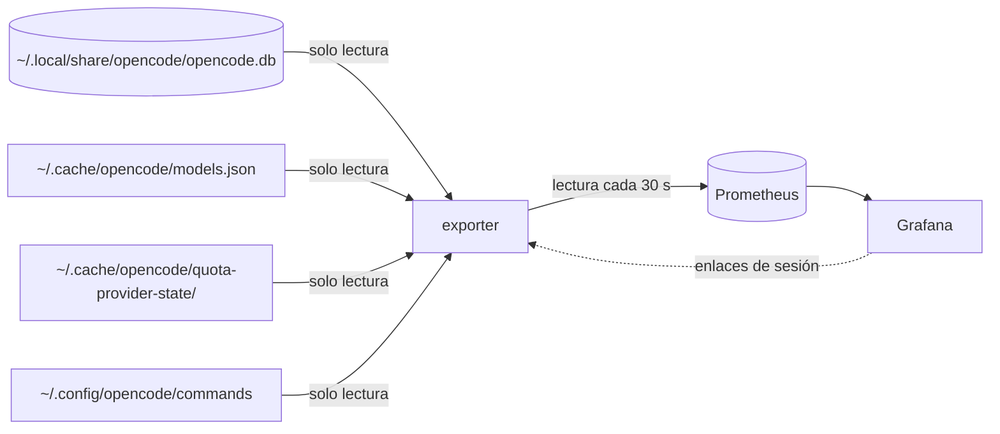

# Métricas de OpenCode

[English](README.md)

Pila local que muestra cuánto usas [OpenCode](https://opencode.ai) y cuánto cuesta. Un exportador pequeño lee la base de datos SQLite del propio OpenCode, Prometheus guarda los totales y Grafana dibuja un dashboard, con historial desde la primera sesión que OpenCode guardó.

No necesita OpenTelemetry ni cambiar la configuración de OpenCode.

## Cómo funciona



| Servicio | Qué hace | Puerto | Persistencia |
| --- | --- | --- | --- |
| `exporter` | Consulta las tablas `message`, `session` y `project`, lee el límite de contexto de cada modelo y publica métricas y las páginas de detalle de sesión | 127.0.0.1:9101 | ninguna |
| `prometheus` | Lee el exportador cada 30 s | 127.0.0.1:9091 | volumen `prometheus-data`, 365 días |
| `grafana` | Dashboard, provisionado automáticamente | 127.0.0.1:3001 | volumen `grafana-data` |

Los puertos son distintos de los de la pila hermana de Claude Code (3000 y 9090), así que pueden funcionar a la vez.

## Requisitos

- Docker con Docker Compose
- OpenCode, con su base de datos en `~/.local/share/opencode/opencode.db` (define `OPENCODE_DATA_DIR` si la tuya está en otro sitio) y su caché de modelos en `~/.cache/opencode/models.json` (`OPENCODE_CACHE_DIR`)

## Puesta en marcha

```bash
cp .env.example .env     # edita .env y define GRAFANA_ADMIN_PASSWORD
docker compose up -d
```

En Windows, `Iniciar-metricas.bat` hace lo mismo: inicia Docker Desktop si hace falta, ejecuta `docker compose up -d` y abre Grafana.

Abre Grafana en <http://localhost:3001> y entra como `admin` con la contraseña de `.env`. El datasource y el dashboard **OpenCode - Uso y coste** ya están ahí; no hay que importar nada.

Grafana lee el fichero del dashboard al arrancar. Tras editar `Grafana/opencode-dashboard.json`, ejecuta `docker compose restart grafana`.

### Límites de contexto

La barra de contexto necesita el límite de contexto de cada modelo. El exportador lo toma del `models.json` de OpenCode; cuando un modelo no está ahí (proveedores propios, algunos modelos de Copilot) su sesión queda fuera de la barra. Indica esos límites en `.env`:

```
CONTEXT_LIMITS=miproveedor/mi-modelo=200000,github-copilot/otro-modelo=128000
```

### Detalle de una sesión

Pulsar el nombre de una sesión en «Contexto de las sesiones recientes» abre `http://localhost:9101/session/<id>` en una pestaña nueva. Esa página la sirve el exportador y la construye desde la base de datos al abrirla. Muestra el título, el proyecto, la duración y el coste de la sesión; la ventana de contexto como una barra dividida en tokens de entrada, caché y salida; un gráfico del tamaño del contexto en cada mensaje, con una línea donde hubo cada compactación; el coste a medida que se acumula; los modelos y agentes usados; las skills, comandos y herramientas llamados, con sus fallos; y las sesiones de subagente que lanzó, cada una con enlace a su propia página. Un enlace arriba vuelve al dashboard.

### Lista de sesiones

La cifra **Sesiones** es un enlace, y también lo es la cabecera de «Contexto de las sesiones recientes»: abren `http://localhost:9101/sessions`, la lista de todas las sesiones creadas en el periodo y el proyecto elegidos, que son las que cuenta la cifra. La lista tiene un cuadro de filtro, columnas que se ordenan al pulsarlas, un enlace al detalle de cada sesión y un interruptor para incluir las sesiones de subagente.

La página solo funciona en la máquina que ejecuta la pila, porque los enlaces del dashboard apuntan a `localhost`.

### Comandos

La tabla de skills cuenta también tus comandos propios (por ejemplo `/ai-commit`). El exportador lee la plantilla de cada comando de `~/.config/opencode/commands` (`OPENCODE_COMMANDS_DIR`), que se monta en solo lectura; solo se monta esa carpeta, no el resto de la configuración de OpenCode, que puede contener claves.

### Informe de mejoras

El exportador analiza tu uso y genera un informe en Markdown pensado para pegarlo en una IA (Claude, OpenCode, ChatGPT…) y pedirle qué cambiar. Incluye unas instrucciones para la IA, un resumen comparado con el periodo anterior, los **hallazgos** que detectan unas reglas automáticas (errores evitables de herramientas, agentes que concentran el coste, llamadas repetidas, sesiones que se compactan varias veces, caché sin uso, acciones bloqueadas por permisos, skills que no cargan, respuestas interrumpidas, comandos con un modelo fijado que da problemas, comandos sin uso o con un proveedor que nunca se ha usado, peso de las variantes `-fast`) y las tablas en las que se basan. No contiene el texto de las conversaciones.

Tres formas de obtenerlo, con el mismo contenido:

- **Grafana:** el enlace **Informe de mejoras (.md)**, arriba a la derecha del dashboard, lo descarga con el periodo y los proyectos elegidos.
- **Navegador:** `http://localhost:9101/report.md?window=30`. Admite `window` (días; `36500` es todo el historial), o `window=0` con `from` y `to` en tiempo Unix, `project` (uno o varios separados por comas) y `anon=1`, que sustituye los nombres de proyecto por `proyecto-1`, `proyecto-2`… `/report.json` devuelve los mismos datos en JSON.
- **Consola:** `docker compose exec exporter python /app/coach/cli.py report --window 30 > informe.md`. Admite también `--from` y `--to` (AAAA-MM-DD), `--project`, `--anon` y `--format json`.

Para reconocer las causas de los errores, el exportador lee el mensaje de error de cada herramienta y lo reduce a una clase (`not_found`, `patch_mismatch`, `permission_rule`…); el texto del error no se guarda ni aparece en el informe. El impacto en dólares de cada hallazgo es un orden de magnitud sobre el coste estimado de OpenCode, no un ahorro garantizado.

## Métricas

| Métrica | Tipo | Etiquetas | Significado |
| --- | --- | --- | --- |
| `opencode_day_cost_usd` | gauge | `day`, `provider`, `model`, `agent`, `project` | Coste que OpenCode estimó para los mensajes del asistente de cada día UTC, sobre todo el historial |
| `opencode_day_tokens` | gauge | las cinco anteriores y `type` (`input`, `output`, `reasoning`, `cache_read`, `cache_write`) | Tokens de cada día |
| `opencode_day_messages` | gauge | `day`, `provider`, `model`, `agent`, `project` | Mensajes del asistente de cada día |
| `opencode_day_sessions` | gauge | `day`, `project` | Sesiones principales creadas cada día (sin las de subagente) |
| `opencode_day_start_seconds` | gauge | `day` | Inicio de cada día UTC como tiempo Unix; el dashboard filtra los días comparándolo, porque PromQL no puede comparar fechas escritas como etiquetas |
| `opencode_day_skill_cost_usd` | gauge | `day`, `kind` (`skill` o `command`), `skill`, `project` | Coste de los turnos en los que se cargó cada skill o se ejecutó cada comando propio; repartido a partes iguales si un turno carga varias skills |
| `opencode_day_skill_activations` | gauge | `day`, `kind`, `skill`, `project`, `result` (`ok` o `error`) | Veces que se cargó cada skill o se ejecutó cada comando propio |
| `opencode_day_skill_detail_cost_usd` | gauge | `day`, `kind`, `skill`, `project`, `provider`, `model`, `agent` | El mismo coste separado por el modelo y el agente que respondieron al turno |
| `opencode_day_skill_detail_activations` | gauge | `day`, `kind`, `skill`, `project`, `provider`, `model`, `agent`, `result` | Las mismas activaciones, atribuidas al modelo y agente del mensaje que cargó la skill o, en un comando, al que más gastó en su turno |
| `opencode_skill_scan_complete` | gauge | ninguna | 1 cuando el exportador ya leyó de la base de datos las llamadas a skills (unos veinte segundos después de arrancar) |
| `opencode_weekly_cost_usd` | gauge | `week`, `project` | Coste por semana, últimas 13; `week` es el lunes de la semana ISO |
| `opencode_weekly_tokens` | gauge | `week`, `project` | Tokens (todos los tipos sumados) por semana |
| `opencode_context_tokens` | gauge | `session`, `label`, `project`, `provider`, `model`, `type` (`input`, `cache_read`, `cache_write`, `output`) | Tokens del último mensaje respondido de cada una de las cinco sesiones más recientes, que es el contexto que ocupa esa sesión |
| `opencode_context_limit_tokens` | gauge | como `opencode_context_tokens`, sin `type` | Límite de contexto del modelo; no existe cuando se desconoce |
| `opencode_quota_remaining_ratio` | gauge | `provider` | Parte de la cuota del proveedor que sigue disponible (de 0 a 1) |
| `opencode_quota_used`, `opencode_quota_limit` | gauge | `provider` | Cuota usada y total, cuando el plugin la da como un par como `22/7000` |
| `opencode_quota_reset_timestamp_seconds` | gauge | `provider` | Cuándo se restablece la cuota |
| `opencode_quota_updated_timestamp_seconds` | gauge | `provider` | Cuándo consultó el plugin la cuota por última vez |
| `opencode_quota_error` | gauge | `provider`, `message` | El plugin no pudo leer la cuota de ese proveedor (por ejemplo `Token expired`) |
| `opencode_cost_usd_total`, `opencode_tokens_total`, `opencode_messages_total` | counter | `provider`, `model`, `agent`, `project` (y `type` en tokens) | Totales acumulados, por si se consultan directamente |
| `opencode_exporter_scrape_seconds` | gauge | ninguna | Tiempo de la última lectura |
| `opencode_day_tool_calls` | gauge | `day`, `tool`, `model`, `project` | Llamadas a herramientas de cada día, para el informe y la fila «Mejoras» |
| `opencode_day_tool_errors` | gauge | `day`, `tool`, `error_class`, `model`, `project` | Llamadas que fallaron, con la clase del error (`not_found`, `patch_mismatch`, `permission_rule`…) |
| `opencode_day_compactions` | gauge | `day`, `project` | Compactaciones de contexto de cada día |
| `opencode_day_aborted` | gauge | `day`, `agent`, `project` | Respuestas interrumpidas de cada día |
| `opencode_weekly_agent_cost_usd`, `opencode_weekly_agent_messages` | gauge | `week`, `agent`, `project` | Coste y mensajes por semana y agente, últimas 13 semanas |
| `opencode_weekly_tool_calls`, `opencode_weekly_tool_errors` | gauge | `week`, `tool` (y `error_class`), `project` | Llamadas y errores por semana y herramienta |
| `opencode_weekly_compactions`, `opencode_weekly_aborted` | gauge | `week`, `project` | Compactaciones e interrupciones por semana |
| `coach_findings` | gauge | `window`, `detector`, `rule`, `severity` | Hallazgos del informe de mejoras para cada periodo del dashboard (7, 30, 90 días y todo el historial); se recalculan cada 10 minutos |
| `coach_finding_impact_usd` | gauge | `window`, `detector`, `rule` | Impacto estimado de esos hallazgos |
| `coach_index_ready`, `coach_findings_updated_timestamp_seconds` | gauge | ninguna | El índice de herramientas ya está leído; cuándo se calcularon los hallazgos |

`project` es el nombre de la carpeta del proyecto; las sesiones que OpenCode no asocia a un proyecto salen como `global`.

## Dashboard

Arriba hay tres selectores. **Periodo** ofrece los últimos 7, 30 o 90 días, todo el historial o **Personalizado**. Con Personalizado, **Desde** y **Hasta** eligen el primer y el último día, entre los días con actividad; con cualquier otro periodo se ignoran. **Proyecto** filtra por proyecto. El selector de tiempo de Grafana está oculto porque los paneles no lo usan. Los días se cuentan en UTC.

> En el formato numérico en español de Grafana «Mil» significa millones. El dashboard muestra los tokens en millones o en miles con el sufijo «M» o «k» para evitar la confusión.

La última fila, **Mejoras**, resume el informe de mejoras y sirve para comprobar después si un cambio funcionó. El enlace **Informe de mejoras (.md)**, arriba a la derecha, descarga el informe completo.

| Panel | Tipo | Qué muestra | Qué aporta |
| --- | --- | --- | --- |
| Coste estimado | Stat | Coste estimado del periodo | La cifra principal de gasto |
| Tokens | Stat | Tokens de entrada, salida, razonamiento y caché, en millones | El volumen global |
| USD por millón de tokens | Stat | Coste dividido entre tokens | El precio efectivo; baja con modelos más baratos o más caché |
| Acierto de caché | Stat | Lectura de caché entre lectura, escritura y entrada | Cuánto contexto se reutiliza en lugar de rehacerse |
| Sesiones | Stat | Sesiones principales creadas en el periodo | Distingue pocas sesiones largas de muchas cortas; pulsa la cifra para ver la lista de sesiones |
| Contexto de las sesiones recientes | Tabla con barras | Para cada una de las cinco sesiones más recientes, el porcentaje de la ventana de contexto del modelo en uso (barra, verde por debajo del 60 %, naranja hasta el 85 %, roja por encima), los tokens usados, los libres y el límite | Muestra lo cerca que está una sesión de su límite; una sesión cuyo modelo no tiene límite conocido sale con «Sin límite»; pulsa una sesión para abrir su detalle y la cabecera del panel enlaza con todas las sesiones; sigue el proyecto, no el periodo |
| Cuota y uso por proveedor | Tabla con barras | Mensajes, tokens y coste de cada proveedor en el periodo y, para los que tienen cuota, el porcentaje usado (barra), lo usado, el total, lo disponible, cuándo se restablece y cuándo se consultó por última vez; si no se puede leer la cuota de un proveedor, sale el mensaje del plugin | Muestra cuánta cuota queda y el uso de los proveedores que no tienen, como los internos o los locales (marcados con «—») |
| Evolución semanal | Barras y línea | Coste por semana (barras, eje izquierdo) y tokens (línea, eje derecho), últimas 13 semanas | Muestra la tendencia; sigue el proyecto pero no el periodo |
| Coste por agente | Barras | Coste por agente (`plan`, `build` y los propios) | Muestra qué modo de trabajo es caro |
| Coste por proyecto | Barras | Coste por carpeta de proyecto | Atribuye el gasto a proyectos |
| Cuota de coste y de tokens por modelo | Barras agrupadas | Para los diez modelos con más coste, su parte del coste total y de los tokens totales; `Otros` suma el resto | Una barra de tokens mucho más larga que la de coste es un modelo barato; al revés, caro |
| Comandos | Tabla anidada | Una fila por comando propio ejecutado en el periodo, de mayor a menor coste: activaciones (barra) y coste de los turnos que lanzó (barra). Al desplegar una fila se ven el agente y el modelo que respondieron, con su parte del coste y las activaciones que se les atribuyen | Muestra qué comandos se usan de verdad y con qué modelos se ejecutaron; el coste incluye el resto del turno, así que es una cota superior; sale vacía si no se usó ninguno en el periodo |
| Skills | Tabla anidada | Una fila por skill cargada en el periodo, de mayor a menor coste: activaciones (barra), coste de los turnos en que se cargó (barra) y cargas fallidas. Al desplegar una fila se ven el agente y el modelo que respondieron, con su parte del coste | Muestra qué skills se usan de verdad y con qué modelos; si un turno carga varias skills su coste se reparte a partes iguales; el coste incluye el resto del turno |
| Detalle por modelo | Tabla | Mensajes, tokens, coste, % del coste y USD por millón de tokens de cada proveedor y modelo, con totales en el pie | Las cifras exactas detrás de los gráficos |
| Coste por día y modelo | Barras apiladas | Coste de cada día del periodo, apilado por los ocho modelos con más coste; `Otros` suma el resto; solo salen los días con actividad | Muestra qué modelo explica el gasto de cada día; se lee bien de 7 a 90 días y se satura con todo el historial |
| Actividad por día y modelo | Tabla | Mensajes, tokens y coste de cada modelo en cada día del periodo, con filtro por columna | Responde a «¿usé el modelo X el día Y?» |
| Mejoras detectadas e Impacto estimado | Cifras | Hallazgos del informe de mejoras en el periodo y la suma de su impacto en dólares; pulsarlas abre el informe | Cuánto hay por mejorar; con el periodo Personalizado no hay cifra |
| Errores evitables de herramientas | Cifra | Parte de las llamadas que fallaron en el periodo, sin bloqueos por permisos, rechazos ni interrupciones | La salud general del uso de herramientas |
| Compactaciones e interrupciones | Cifra doble | Compactaciones de contexto y respuestas interrumpidas en el periodo | Señales de sesiones demasiado largas o de prompts que arrancan mal |
| Hallazgos por regla | Tabla | Hallazgos, cuántos de severidad alta e impacto, por regla del informe | Qué tipo de mejora pesa más |
| Errores evitables por herramienta y modelo | Tabla | Llamadas, errores y tasa de cada herramienta con cada modelo que haya fallado; naranja desde el 5 %, rojo desde el 15 % | Dónde compensa una regla en AGENTS.md o cambiar de modelo |
| Coste por mensaje de cada agente, por semana | Líneas | Coste medio por mensaje de cada agente, últimas 13 semanas | Comprueba si cambiar el modelo de un agente baja su coste |
| Errores evitables por herramienta, por semana | Líneas | Tasa de error semanal de las cinco herramientas con más errores | Comprueba si una regla nueva o un cambio de modelo reduce los fallos |
| Compactaciones e interrupciones, por semana | Barras | Las dos cifras por semana, últimas 13 | La tendencia de esas dos señales |

## Limitaciones

- El coste es la estimación que OpenCode guarda en cada mensaje. No es una factura, y en proveedores por suscripción puede no reflejar lo que realmente pagas.
- El contexto mostrado es el tamaño del último mensaje respondido de cada sesión, como en la barra lateral de OpenCode. Una sesión cuyo modelo no tiene límite conocido sale con «Sin límite» en lugar de un porcentaje hasta que lo añades a `CONTEXT_LIMITS`.
- El coste de una skill no se puede aislar. El panel suma el coste de cada turno (todos los mensajes del asistente que responden a un mensaje del usuario) en el que se cargó la skill, así que incluye todo lo demás que pasó en el turno. Si un turno carga varias skills, el coste se reparte a partes iguales.
- Los comandos propios no dejan marca en la base de datos: OpenCode guarda la plantilla ya expandida como texto del mensaje del usuario. El exportador reconoce un comando cuando un mensaje empieza con su plantilla, así que solo ve los de la carpeta global de comandos, no los definidos dentro de un proyecto, y no cuenta dos comandos cuyas plantillas empiezan igual.
- Encontrar las llamadas a skills exige leer la tabla `part`, que guarda todas las salidas de herramientas y es lenta de recorrer a través de Docker; el exportador la lee una vez en segundo plano al arrancar y después solo lo nuevo. Los paneles de skills se rellenan unos veinte segundos después de reiniciar.
- La cuota sale de los ficheros de estado que cachea el plugin `opencode-quota`, así que solo existe para los proveedores que ese plugin soporta y es tan reciente como su última consulta. Sin el plugin las columnas de cuota quedan vacías. Un proveedor que informa de varias cuotas muestra la que menos le queda. Los proveedores internos y locales no tienen cuota.
- Todo se recalcula desde la base de datos en cada lectura (unos tres segundos hoy). Si OpenCode borra sesiones, los totales bajan y Prometheus trata los contadores acumulados como reinicios.
- El gráfico semanal cubre 13 semanas sea cual sea el periodo, y `Otros` puede salir en cualquier posición del gráfico de modelos porque las barras se ordenan por cuota de coste.
- Las listas de Desde y Hasta solo contienen días con actividad y se leen al cargar el dashboard.
- Si la base de datos está en un montaje de solo lectura sin sus ficheros de registro de escritura, el exportador recurre a una lectura inmutable y puede ir retrasado respecto a los últimos megabytes escritos.
- No hay copias de seguridad.

## Seguridad y privacidad

- Los puertos se publican solo en `127.0.0.1` y la contraseña de Grafana sale de `.env`, que git ignora.
- La carpeta de datos de OpenCode también contiene `auth.json` y tablas de credenciales, y su carpeta de caché contiene paquetes descargados. Ambas se montan en solo lectura y el exportador abre solo `opencode.db`, `models.json` y los ficheros de estado de la cuota, pero ejecuta únicamente código en el que confíes. De los ficheros de cuota lee el porcentaje, las cantidades, la fecha de reinicio y el texto del error, nunca la clave que también contienen.
- El exportador lee metadatos de los mensajes (rol, modelo, agente, coste, tokens, fechas). No guarda ni publica el texto de los mensajes. Para reconocer los comandos propios compara el comienzo de cada mensaje del usuario con las plantillas de los comandos y se queda solo con el nombre del que coincide; de las skills lee solo el nombre y el resultado de cada llamada, nunca lo que devolvieron. La tabla de contexto sí muestra los títulos de tus cinco sesiones más recientes, que OpenCode deriva de tus conversaciones; tenlo en cuenta antes de compartir capturas.
- Las páginas de detalle de sesión y la lista de sesiones se sirven en `127.0.0.1:9101` sin autenticación. Muestran el título de la sesión, el proyecto, los modelos, los costes y los nombres de las herramientas, skills y comandos usados, nunca el texto de la conversación.
- Los nombres de proyecto (nombres de carpeta) aparecen como etiquetas.
- El informe de mejoras (`/report.md`) contiene cifras, nombres de modelos, agentes, herramientas, skills, comandos y proyectos, e identificadores de sesión; nunca texto de las conversaciones ni de los errores. Usa `anon=1` para ocultar los nombres de proyecto antes de compartirlo.

## Estructura del repositorio

```
docker-compose.yml          servicios, puertos y volúmenes
exporter/exporter.py        exportador SQLite → Prometheus y páginas de sesión
exporter/session_page.py    HTML de la página de detalle de sesión
exporter/coach/             informe de mejoras: análisis, reglas, Markdown y consola
prometheus.yml              lectura del exportador
grafana-datasource.yaml     datasource provisionado
grafana-dashboards.yaml     proveedor de dashboards
Grafana/                    JSON del dashboard
.env.example                variables para copiar a .env
Iniciar-metricas.bat        lanzador para Windows
```

## Licencia

[MIT](LICENSE): puedes usar, modificar y redistribuir el código, también con fines comerciales, siempre que conserves el aviso de copyright y la licencia.
