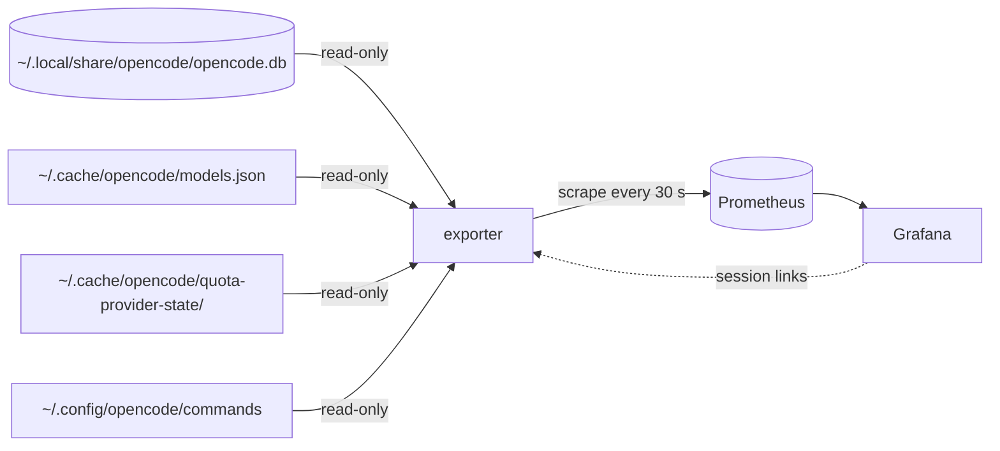

# OpenCode metrics

[Español](README.es.md)

A local stack that shows how much [OpenCode](https://opencode.ai) you use and what it costs. A small exporter reads OpenCode's own SQLite database, Prometheus stores the totals and Grafana draws a dashboard, with history from the first session OpenCode ever saved.

It does not need OpenTelemetry or any change to OpenCode's configuration.

## How it works



| Service | Role | Port | Storage |
| --- | --- | --- | --- |
| `exporter` | Queries the `message`, `session` and `project` tables and reads each model's context limit; publishes metrics and the session detail pages | 127.0.0.1:9101 | none |
| `prometheus` | Scrapes the exporter every 30 s | 127.0.0.1:9091 | volume `prometheus-data`, 365 days |
| `grafana` | Dashboard, provisioned automatically | 127.0.0.1:3001 | volume `grafana-data` |

The ports differ from those of the sibling Claude Code stack (3000 and 9090), so both can run at the same time.

## Requirements

- Docker with Docker Compose
- OpenCode, with its database at `~/.local/share/opencode/opencode.db` (set `OPENCODE_DATA_DIR` if yours lives elsewhere) and its models cache at `~/.cache/opencode/models.json` (`OPENCODE_CACHE_DIR`)

## Quick start

```bash
cp .env.example .env     # then edit .env and set GRAFANA_ADMIN_PASSWORD
docker compose up -d
```

On Windows, `Iniciar-metricas.bat` does the same: it starts Docker Desktop if needed, runs `docker compose up -d` and opens Grafana.

Open Grafana at <http://localhost:3001> and sign in as `admin` with the password from `.env`. The datasource and the dashboard **OpenCode - Uso y coste** are already there; nothing has to be imported.

Grafana reads the dashboard file when it starts. After editing `Grafana/opencode-dashboard.json`, run `docker compose restart grafana`.

### Context limits

The context bar needs each model's context limit. The exporter takes it from OpenCode's `models.json`; when a model is not there (custom providers, some Copilot models) its session is left out of the bar. List those limits in `.env`:

```
CONTEXT_LIMITS=myprovider/my-model=200000,github-copilot/some-model=128000
```

### Session detail

Clicking a session name in «Contexto de las sesiones recientes» opens `http://localhost:9101/session/<id>` in a new tab. The exporter serves that page and builds it from the database when you open it. It shows the title, project, duration and cost of the session; the context window as a bar split into input, cache and output tokens; a chart of the context size at every message with a line where each compaction happened; the cost as it accumulates; the models and agents used; the skills, commands and tools called, with their failures; and the subagent sessions it spawned, each linking to its own page. A link at the top returns to the dashboard.

### Sessions list

The **Sesiones** figure is a link, and so is the header of «Contexto de las sesiones recientes»: they open `http://localhost:9101/sessions`, the list of every session created in the selected period and project, which are the ones the figure counts. The list has a filter box, columns that sort when clicked, a link to the detail page of each session and a switch to include the subagent sessions.

The page only works on the machine that runs the stack, because the dashboard's links point to `localhost`.

### Commands

The skills table also counts your custom commands (for example `/ai-commit`). The exporter reads the template of each command from `~/.config/opencode/commands` (`OPENCODE_COMMANDS_DIR`), which is mounted read-only; only that folder is mounted, not the rest of OpenCode's configuration, which can hold keys.

### Improvement report

The exporter analyses your usage and builds a Markdown report meant to be pasted into an AI (Claude, OpenCode, ChatGPT…) to ask what to change. It holds instructions for the AI, a summary compared with the previous period, the **findings** of a set of automatic rules (avoidable tool errors, agents that concentrate the cost, repeated calls, sessions compacted several times, unused cache, actions blocked by permissions, skills that fail to load, interrupted answers, commands whose pinned model has problems, unused commands or commands pinned to a provider never used, weight of `-fast` variants) and the tables behind them. It holds no conversation text. The report is written in Spanish.

Three ways to get it, with the same content:

- **Grafana:** the **Informe de mejoras (.md)** link, at the top right of the dashboard, downloads it for the selected period and projects.
- **Browser:** `http://localhost:9101/report.md?window=30`. It takes `window` (days; `36500` is all history), or `window=0` with `from` and `to` as Unix time, `project` (one or several, comma-separated) and `anon=1`, which replaces project names with `proyecto-1`, `proyecto-2`… `/report.json` returns the same data as JSON.
- **Command line:** `docker compose exec exporter python /app/coach/cli.py report --window 30 > report.md`. It also takes `--from` and `--to` (YYYY-MM-DD), `--project`, `--anon` and `--format json`.

To tell the causes of errors apart, the exporter reads each tool's error message and reduces it to a class (`not_found`, `patch_mismatch`, `permission_rule`…); the error text is neither kept nor shown in the report. The dollar impact of each finding is an order of magnitude based on OpenCode's estimated cost, not a guaranteed saving.

## Metrics

| Metric | Type | Labels | Meaning |
| --- | --- | --- | --- |
| `opencode_day_cost_usd` | gauge | `day`, `provider`, `model`, `agent`, `project` | Cost that OpenCode estimated for the assistant messages of each UTC day, over all history |
| `opencode_day_tokens` | gauge | the five above plus `type` (`input`, `output`, `reasoning`, `cache_read`, `cache_write`) | Tokens of each day |
| `opencode_day_messages` | gauge | `day`, `provider`, `model`, `agent`, `project` | Assistant messages of each day |
| `opencode_day_sessions` | gauge | `day`, `project` | Main sessions created each day (subagent sessions excluded) |
| `opencode_day_start_seconds` | gauge | `day` | Start of each UTC day as a Unix time; the dashboard filters days by comparing it, because PromQL cannot compare dates written as labels |
| `opencode_day_skill_cost_usd` | gauge | `day`, `kind` (`skill` or `command`), `skill`, `project` | Cost of the turns in which each skill was loaded or each custom command run; split equally when one turn loads several skills |
| `opencode_day_skill_activations` | gauge | `day`, `kind`, `skill`, `project`, `result` (`ok` or `error`) | Times each skill was loaded or each custom command run |
| `opencode_day_skill_detail_cost_usd` | gauge | `day`, `kind`, `skill`, `project`, `provider`, `model`, `agent` | The same cost split by the model and agent that answered the turn |
| `opencode_day_skill_detail_activations` | gauge | `day`, `kind`, `skill`, `project`, `provider`, `model`, `agent`, `result` | The same activations, credited to the model and agent of the message that loaded the skill or, for a command, to the one that spent most in its turn |
| `opencode_skill_scan_complete` | gauge | none | 1 once the exporter has read the skill calls from the database (about twenty seconds after it starts) |
| `opencode_weekly_cost_usd` | gauge | `week`, `project` | Cost per week, last 13 weeks; `week` is the Monday of the ISO week |
| `opencode_weekly_tokens` | gauge | `week`, `project` | Tokens (all types added up) per week |
| `opencode_context_tokens` | gauge | `session`, `label`, `project`, `provider`, `model`, `type` (`input`, `cache_read`, `cache_write`, `output`) | Tokens of the last answered message of each of the five most recent sessions, which is the context that session occupies |
| `opencode_context_limit_tokens` | gauge | as `opencode_context_tokens`, without `type` | The model's context limit; absent when it is unknown |
| `opencode_quota_remaining_ratio` | gauge | `provider` | Share of the provider's quota still available (0 to 1) |
| `opencode_quota_used`, `opencode_quota_limit` | gauge | `provider` | Quota used and total, when the plugin reports them as a pair such as `22/7000` |
| `opencode_quota_reset_timestamp_seconds` | gauge | `provider` | When the quota resets |
| `opencode_quota_updated_timestamp_seconds` | gauge | `provider` | When the plugin last checked the quota |
| `opencode_quota_error` | gauge | `provider`, `message` | The plugin could not read that provider's quota (for example `Token expired`) |
| `opencode_cost_usd_total`, `opencode_tokens_total`, `opencode_messages_total` | counter | `provider`, `model`, `agent`, `project` (and `type` for tokens) | Cumulative totals, kept for anyone querying them directly |
| `opencode_exporter_scrape_seconds` | gauge | none | Time the last scrape took |
| `opencode_day_tool_calls` | gauge | `day`, `tool`, `model`, `project` | Tool calls per day, for the report and the «Mejoras» row |
| `opencode_day_tool_errors` | gauge | `day`, `tool`, `error_class`, `model`, `project` | Calls that failed, with the error class (`not_found`, `patch_mismatch`, `permission_rule`…) |
| `opencode_day_compactions` | gauge | `day`, `project` | Context compactions per day |
| `opencode_day_aborted` | gauge | `day`, `agent`, `project` | Interrupted answers per day |
| `opencode_weekly_agent_cost_usd`, `opencode_weekly_agent_messages` | gauge | `week`, `agent`, `project` | Cost and messages per week and agent, last 13 weeks |
| `opencode_weekly_tool_calls`, `opencode_weekly_tool_errors` | gauge | `week`, `tool` (and `error_class`), `project` | Calls and errors per week and tool |
| `opencode_weekly_compactions`, `opencode_weekly_aborted` | gauge | `week`, `project` | Compactions and interruptions per week |
| `coach_findings` | gauge | `window`, `detector`, `rule`, `severity` | Findings of the improvement report for each dashboard period (7, 30, 90 days and all history); recomputed every 10 minutes |
| `coach_finding_impact_usd` | gauge | `window`, `detector`, `rule` | Estimated impact of those findings |
| `coach_index_ready`, `coach_findings_updated_timestamp_seconds` | gauge | none | The tool index has been read; when the findings were computed |

`project` is the name of the project folder; sessions OpenCode does not tie to a project are reported as `global`.

## Dashboard

Three selectors sit at the top. **Periodo** offers the last 7, 30 or 90 days, all history, or **Personalizado**. With Personalizado, **Desde** and **Hasta** choose the first and last day, from the days that have activity; with any other period they are ignored. **Proyecto** filters by project. Grafana's own time picker is hidden because the panels do not use it. Days are counted in UTC.

> In Grafana's Spanish number format «Mil» means millions. The dashboard shows tokens in millions or thousands with an «M» or «k» suffix to avoid the confusion.

The last row, **Mejoras**, summarises the improvement report and lets you check afterwards whether a change worked. The **Informe de mejoras (.md)** link, at the top right, downloads the full report.

| Panel | Type | What it shows | What it is for |
| --- | --- | --- | --- |
| Coste estimado | Stat | Estimated cost of the period | The headline spend figure |
| Tokens | Stat | Input, output, reasoning and cache tokens, in millions | Overall volume |
| USD por millón de tokens | Stat | Cost divided by tokens | The effective price; it falls with cheaper models or more cache |
| Acierto de caché | Stat | Cache reads over cache reads, cache writes and input | How much context is reused instead of rebuilt |
| Sesiones | Stat | Main sessions created in the period | Tells a few long sessions from many short ones; click the figure for the list of sessions |
| Contexto de las sesiones recientes | Table with bars | For each of the five most recent sessions, the percentage of the model's context window in use (bar, green below 60 %, orange to 85 %, red above), the tokens used, the tokens free and the limit | Shows how close a session is to its limit; a session whose model has no known limit shows «Sin límite»; click a session to open its detail, and the panel header links to every session; follows the project but not the period |
| Cuota y uso por proveedor | Table with bars | Messages, tokens and cost of each provider in the period and, for providers that have a quota, the percentage used (bar), the amount used, the total, what is available, when it resets and when it was last checked; a provider whose quota cannot be read shows the plugin's message | Shows how much of a quota is left, and the usage of providers without one, such as internal or local ones (marked «—») |
| Evolución semanal | Bars and line | Cost per week (bars, left axis) and tokens (line, right axis), last 13 weeks | Shows the trend; follows the project but not the period |
| Coste por agente | Bars | Cost per agent (`plan`, `build` and any custom ones) | Shows which working mode is expensive |
| Coste por proyecto | Bars | Cost per project folder | Attributes spend to projects |
| Cuota de coste y de tokens por modelo | Grouped bars | For the ten models with the highest cost, their share of the total cost and of the total tokens; `Otros` adds up the rest | A tokens bar much longer than the cost bar is a cheap model; the reverse is an expensive one |
| Comandos | Nested table | One row per custom command run in the period, from most to least expensive: activations (bar) and the cost of the turns it launched (bar). Expand a row to see the agent and model that answered, each with its share of the cost and the activations credited to it | Shows which commands are really used and which models they ran on; the cost includes the rest of the turn, so it is an upper bound; empty when none was used in the period |
| Skills | Nested table | One row per skill loaded in the period, from most to least expensive: activations (bar), the cost of the turns that loaded it (bar) and failed loads. Expand a row to see the agent and model that answered, with their share of the cost | Shows which skills are really used and on which models; when a turn loads several skills its cost is split equally; the cost includes the rest of the turn |
| Detalle por modelo | Table | Messages, tokens, cost, share of cost and USD per million tokens for each provider and model, with totals in the footer | The exact figures behind the charts |
| Coste por día y modelo | Stacked bars | Cost of each day of the period, stacked by the eight models with the highest cost; `Otros` adds up the rest; only days with activity appear | Shows which model drove each day's spend; readable for 7 to 90 days, crowded for all history |
| Actividad por día y modelo | Table | Messages, tokens and cost of each model on each day of the period, with a column filter | Answers "did I use model X on day Y" |
| Mejoras detectadas and Impacto estimado | Stats | Findings of the improvement report in the period and the sum of their dollar impact; clicking opens the report | How much there is to improve; no figure with the custom period |
| Errores evitables de herramientas | Stat | Share of tool calls that failed in the period, without permission blocks, rejections or interruptions | Overall health of tool use |
| Compactaciones e interrupciones | Double stat | Context compactions and interrupted answers in the period | Signs of sessions that run too long or prompts that start badly |
| Hallazgos por regla | Table | Findings, how many are high severity, and impact, per report rule | Which kind of improvement weighs most |
| Errores evitables por herramienta y modelo | Table | Calls, errors and rate of each tool with each model that failed; orange from 5 %, red from 15 % | Where a rule in AGENTS.md or another model pays off |
| Coste por mensaje de cada agente, por semana | Lines | Average cost per message of each agent, last 13 weeks | Checks whether changing an agent's model lowers its cost |
| Errores evitables por herramienta, por semana | Lines | Weekly error rate of the five tools with most errors | Checks whether a new rule or another model reduces failures |
| Compactaciones e interrupciones, por semana | Bars | Both figures per week, last 13 | The trend of those two signals |

## Limitations

- Cost is the estimate OpenCode stores for each message. It is not an invoice, and for subscription-based providers it may not reflect what you actually pay.
- The context shown is the size of each session's last answered message, as in OpenCode's own sidebar. A session whose model has no known limit shows «Sin límite» instead of a percentage until you add it to `CONTEXT_LIMITS`.
- A skill's cost cannot be isolated. The panel adds up the cost of every turn (all the assistant messages that answer one user message) in which the skill was loaded, so it includes everything else that happened in the turn. When a turn loads several skills the cost is split equally.
- Custom commands leave no mark in the database: OpenCode stores the expanded template as the text of the user message. The exporter recognises a command when a message opens with its template, so it only sees the commands of the global commands folder, not those defined inside a project, and two commands whose templates open identically are not counted.
- Finding skill calls means reading the `part` table, which holds every tool output and is slow to scan through Docker; the exporter reads it once in the background after it starts, then only what is new. The skill panels fill in about twenty seconds after a restart.
- Quota comes from the state files that the `opencode-quota` plugin caches, so it exists only for the providers that plugin supports and is as recent as its last check. Without the plugin the quota columns are empty. A provider that reports several quotas shows the one with the least left. Internal and local providers have no quota.
- Everything is recomputed from the database on every scrape (about three seconds today). If OpenCode deletes sessions, totals drop and Prometheus treats the cumulative counters as resets.
- The weekly chart covers 13 weeks whatever the period, and `Otros` can appear anywhere in the model chart because bars are ordered by cost share.
- The Desde and Hasta lists only contain days with activity, and they are read when the dashboard loads.
- If the database sits on a read-only mount without its write-ahead log files, the exporter falls back to an immutable read and can lag behind by the latest few megabytes of writes.
- Nothing is backed up.

## Security and privacy

- Ports are published on `127.0.0.1` only, and Grafana's password comes from `.env`, which git ignores.
- OpenCode's data folder also holds `auth.json` and credential tables, and its cache folder holds downloaded packages. Both are mounted read-only and the exporter opens only `opencode.db`, `models.json` and the quota state files, but only run code you trust against them. From the quota files it reads the percentage, the amounts, the reset time and the error text, never the key they also hold.
- The exporter reads message metadata (role, model, agent, cost, token counts, timestamps). It does not keep or publish message text. To recognise custom commands it compares the opening of each user message with the command templates and keeps only the name of the command that matches; for skills it reads only the name and the outcome of each call, never what the skill returned. The context table does show the titles of your five most recent sessions, which OpenCode derives from your conversations, so keep that in mind before sharing screenshots.
- The session detail pages and the sessions list are served on `127.0.0.1:9101` without authentication. They show the session title, project, models, costs and the names of the tools, skills and commands used, never the text of the conversation.
- Project names (folder names) appear as labels.
- The improvement report (`/report.md`) holds figures, the names of models, agents, tools, skills, commands and projects, and session ids; never the text of conversations or errors. Use `anon=1` to hide project names before sharing it.

## Repository layout

```
docker-compose.yml          services, ports and volumes
exporter/exporter.py        SQLite → Prometheus exporter, and the session pages
exporter/session_page.py    HTML of the session detail page
exporter/coach/             improvement report: analysis, rules, Markdown and command line
prometheus.yml              scrape of the exporter
grafana-datasource.yaml     provisioned datasource
grafana-dashboards.yaml     dashboard provider
Grafana/                    dashboard JSON
.env.example                variables to copy into .env
Iniciar-metricas.bat        Windows launcher
```

## License

[MIT](LICENSE): you can use, modify and redistribute the code, including commercially, as long as you keep the copyright and license notice.
